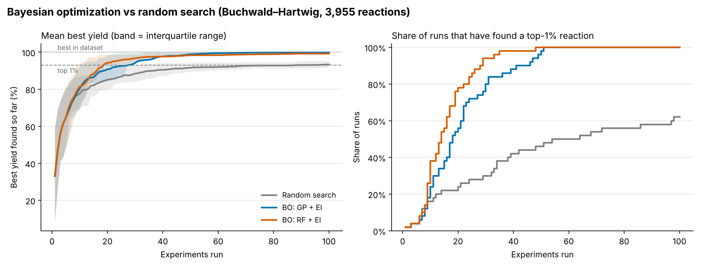
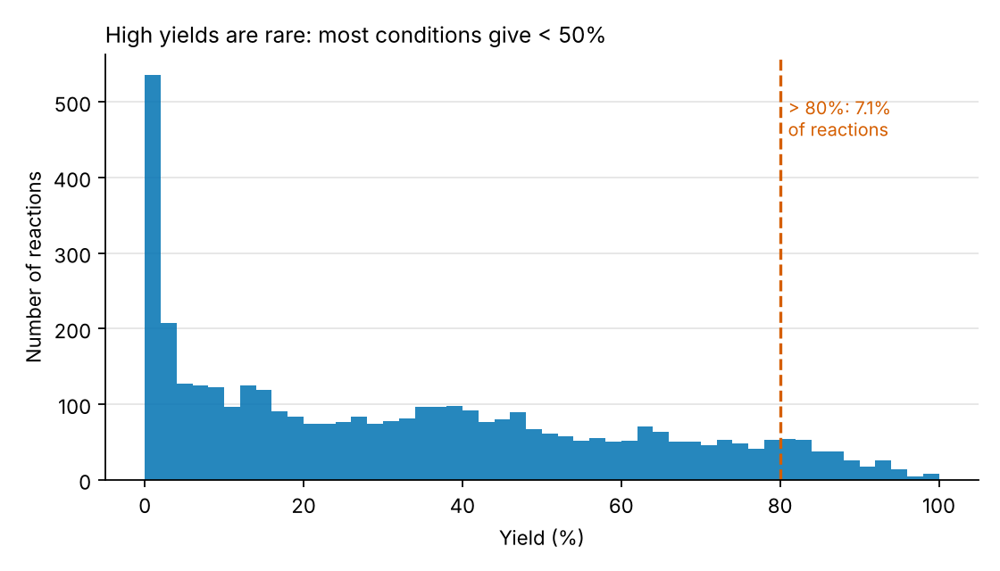
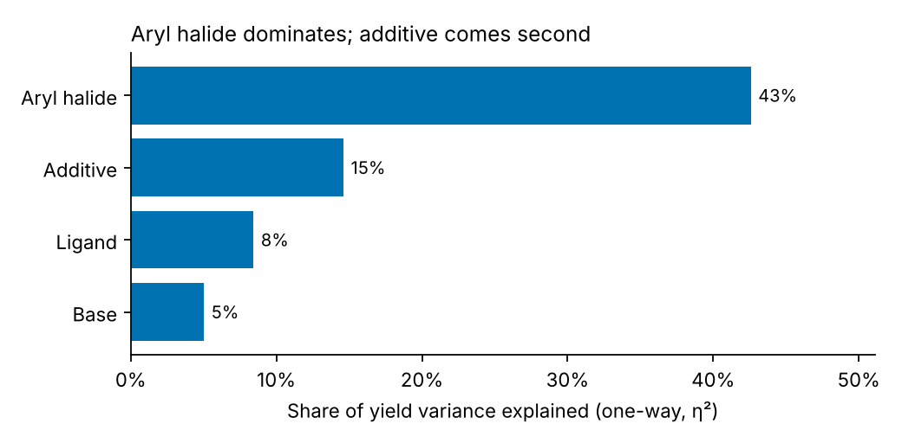
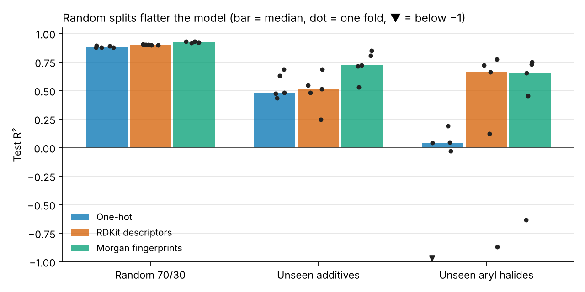
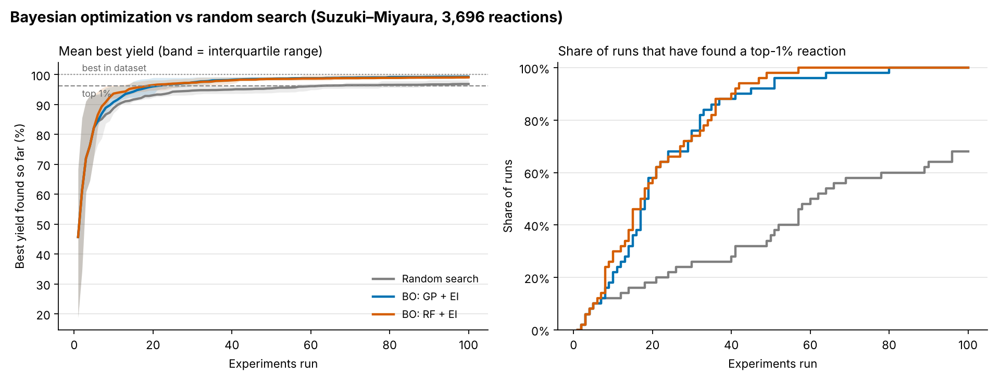
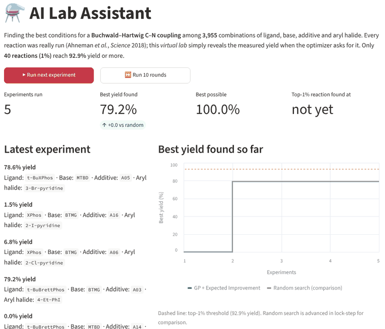

# AI Lab Assistant: Bayesian reaction optimization

**A Bayesian optimizer that finds a top-1% Buchwald–Hartwig reaction in a median of 14–18 experiments. Random search needs about 68 on average, and still fails in more than a third of runs after 100. The result repeats on a second reaction (Suzuki–Miyaura): about 18 experiments, against about 69.**



*Left: best yield found so far (mean over 50 seeds; band = interquartile range). Right: the share of runs that have found one of the 40 best reactions (≥ 92.9% yield).*

---

## The problem

Chemists optimizing a reaction have to choose a ligand, a base, an additive and so on. The number of combinations multiplies quickly, and each experiment costs reagents and bench time. A trial-and-error search through 4,000 combinations is not practical.

**Bayesian optimization (BO)** treats this as a search problem. After every experiment it fits a statistical model of "conditions → yield", including how *uncertain* it is, and picks the next experiment that best balances *promising* and *informative*.

## How it works

```
             ┌──────────────────────────────────────────────────────┐
             │                    VIRTUAL LAB                       │
             │  3,955 real reactions (Ahneman et al., Science 2018) │
             │  4 ligands × 3 bases × 22 additives × 15 aryl halides│
             └───────────────▲───────────────────────┬──────────────┘
          "run" conditions x │                       │ measured yield y
                             │                       ▼
 ┌───────────────────────────┴───┐        ┌─────────────────────────────┐
 │ ACQUISITION FUNCTION          │◀───────│ SURROGATE MODEL             │
 │ Expected Improvement / UCB:   │ mean + │ Gaussian process (Matérn 5/2│
 │ pick the untested reaction    │ uncert.│ + noise) or random forest,  │
 │ most likely to beat the best  │        │ refit on all results so far │
 └───────────────────────────────┘        └─────────────────────────────┘
```

1. Run 5 random experiments.
2. Fit the surrogate model on every result so far.
3. Score every untested reaction with the acquisition function and run the best one.
4. Repeat until the budget is spent.

Every reaction in the dataset was actually run, so the **virtual lab** (`src/virtual_lab.py`) "runs" an experiment by looking up its measured yield. Optimizers only see the results they asked for.

## Results

### Phase 1: the search space ([`results/eda_summary.md`](results/eda_summary.md))

- 3,955 reactions with no missing values or duplicates. The full factorial would be 3,960, so 5 combinations were never reported.
- High yields are rare: **7.1% of reactions exceed 80%**, **1.8% exceed 90%**, and the top 1% (40 reactions) need **≥ 92.9%**. Mean yield is 33%.
- The aryl halide alone explains 43% of yield variance, the additive 15%, the ligand 8% and the base 5%. The remaining ~29% comes from *interactions*, which is why a simple "pick the best of each" approach fails.

| Yield distribution | Variance explained |
|---|---|
|  |  |

More EDA figures: [yield by variable](results/figures/eda_yield_by_variable.png), [ligand × aryl-halide heatmap](results/figures/eda_ligand_halide_heatmap.png).

### Phase 2: is yield learnable? ([`results/baseline_metrics.md`](results/baseline_metrics.md))

Random-forest yield predictor, three encodings, three kinds of split:

| Split | One-hot R² | RDKit descriptors R² | Morgan fingerprints R² |
|---|---|---|---|
| Random 70/30 | 0.88 | 0.90 | **0.92** |
| Unseen additives (GroupKFold) | 0.48 | 0.52 | **0.72** |
| Unseen aryl halides (GroupKFold) | 0.04 | **0.66** | **0.66** |

*Median R² over 5 folds; per-fold values are in the linked file.*

**Random splits are flattering.** A model that looks excellent (R² ≈ 0.9) drops sharply on reagents it has never seen. One-hot encoding cannot generalize to a new aryl halide at all (R² ≈ 0), while chemistry-aware features can.



### Phase 4: optimization benchmark ([`results/main_metrics.md`](results/main_metrics.md))

50 seeds per method, budget 100 experiments, all methods share the same 5 random starting experiments for a given seed.

| Method | Best yield after 10 | after 20 | after 50 | Runs that found a top-1% reaction | Median experiments to top-1% |
|---|---|---|---|---|---|
| Random search | 77.6 ± 14.1 | 85.1 ± 8.5 | 91.6 ± 4.3 | 62% | 59 (analytic: 68 median, 96 mean) |
| **BO: GP + EI** | 80.5 ± 15.0 | 90.7 ± 9.2 | **98.8 ± 1.9** | **100%** (by experiment 51) | **18** |
| **BO: RF + EI** | 81.6 ± 16.9 | **94.3 ± 6.6** | 98.3 ± 2.1 | **100%** (by experiment 48) | **14** |

- BO reaches a top-1% reaction about **4× faster** than random search. Every BO run got there within ~50 experiments.
- By 100 experiments, GP-EI finds essentially the best reaction in the dataset (99.9 ± 0.2%), while random search averages 93%.
- The analytic random-search numbers come from sampling without replacement: 40 "good" reactions out of 3,955 give an expected (N+1)/(K+1) = 96 draws and a median of 68. The 50-seed simulation agrees within sampling noise.

### Phase 5: extensions

Each extension uses 30 seeds and a budget of 100, and each has its own chart in `results/figures/`.

**a) Chemistry-aware features inside BO: this did not help.** ([chart](results/figures/encodings_benchmark.png), [table](results/encodings_metrics.md))

| GP-EI encoding | Best after 20 | Median exps to top-1% | Runs found top-1% |
|---|---|---|---|
| One-hot | 89.4 ± 9.5 | **20** | 100% |
| Morgan fingerprints | 85.5 ± 10.1 | 30 | 100% |
| RDKit descriptors | 86.2 ± 10.0 | 37 | 93% |

*Takeaway:* features that help a model **generalize to new reagents** (Phase 2) did not speed up search **within a fixed, fully known set of reagents**. Here one-hot already lets the GP learn a separate effect for each choice. The isotropic kernel also gives every descriptor equal weight, so the 16 descriptors of the 3 bases count as much as those of the aryl halide, which matters far more. Per-component kernels or automatic relevance determination (ARD) would be the next things to try.

**b) Batch mode: plates of 5 in parallel.** ([chart](results/figures/batch_benchmark.png), [table](results/batch_metrics.md))

| Strategy | Median exps to top-1% | ≈ rounds (plates) | Runs found top-1% |
|---|---|---|---|
| Sequential GP-EI (q = 1) | 20 | 20 | 100% |
| Batch GP-EI (q = 5, kriging believer) | 28 | **~6** | 97% |
| Random, batch of 5 | 68 | ~14 | 70% |

*Takeaway:* batching costs about 40% more experiments but needs about **3× fewer rounds**. When a round is a day at the bench, this is the setting a real lab would use.

**c) Exploration vs exploitation.** ([chart](results/figures/acquisition_benchmark.png), [table](results/acquisition_metrics.md))

| Acquisition | Median exps to top-1% | Runs found top-1% within 100 |
|---|---|---|
| Greedy (posterior mean only) | 21 | 93% |
| UCB β = 0.1 | 20 | 93% |
| UCB β = 1 | 19 | 100% |
| UCB β = 4 | 20 | 100% |
| UCB β = 16 | 16 | 100% |
| EI | 20 | 100% |

*Takeaway:* the *median* run barely depends on the acquisition function. The difference shows up in the *worst* runs: purely exploitative strategies (greedy, β = 0.1) get stuck on a "good enough" plateau in 7% of runs and never find a top-1% reaction. Some exploration is cheap insurance.

**d) Second dataset: Suzuki–Miyaura.** ([chart](results/figures/suzuki_miyaura_main_benchmark.png), [table](results/suzuki_miyaura_main_metrics.md), [EDA](results/suzuki_miyaura_eda_summary.md))

The same code, unchanged, on 3,696 Suzuki–Miyaura couplings (Perera et al., 2018): 4 electrophiles × 3 boron reagents × 11 ligands × 7 bases × 4 solvents. This search space is easier, since 17.8% of reactions exceed 80%, so the target is stricter: the top 1% need ≥ 96.2% yield (37 reactions).

| Method (50 seeds) | Best after 10 | after 20 | Runs found top-1% | Median exps to top-1% |
|---|---|---|---|---|
| Random search | 88.8 ± 9.2 | 93.1 ± 4.7 | 68% | 61 (analytic: 69 median, 97 mean) |
| BO: GP + EI | 90.8 ± 7.9 | 96.0 ± 3.1 | **100%** | **18** |
| BO: RF + EI | **93.6 ± 4.8** | **96.5 ± 2.1** | **100%** | **18** |

The encodings result also repeats ([chart](results/figures/suzuki_miyaura_encodings_benchmark.png), [table](results/suzuki_miyaura_encodings_metrics.md)): one-hot needs a median of 18 experiments, Morgan fingerprints 28 and RDKit descriptors 30.



*Takeaway:* the ~4× saving is not a quirk of one dataset. Both reactions land at a median of about 18 experiments, even though their search spaces have different sizes, different components and different shares of high-yield reactions.

**e) Robustness to measurement noise** (an extra extension). ([chart](results/figures/noise_benchmark.png), [table](results/noise_metrics.md))

Gaussian noise was added to every "measured" yield. Methods are still scored on the true yield of what they picked.

| Noise | Median exps to top-1% | Runs found top-1% |
|---|---|---|
| None | 20 | 100% |
| ± 5% (SD) | 18 | 100% |
| ± 10% (SD) | 26 | 100% |
| Random search (reference) | 46 | 67% |

*Takeaway:* the GP's learned noise term absorbs realistic plate-reader noise. At ±10%, BO slows down but still beats random search clearly.

## What didn't work, and limitations

- **Chemistry-aware features did not help the optimizer** in this setting (see 5a), even though they clearly help prediction on unseen reagents.
- **Batch BO is less sample-efficient** than sequential BO. It saves rounds, not reagents.
- **A virtual lab is not a real lab.** The candidate set is fixed and fully enumerated, so the optimizer can never propose a new reagent, temperature or concentration. Yields come from one high-throughput campaign with its own systematic errors, and real experiments fail in ways a lookup table never does.
- **Two datasets, both from one type of experiment.** Both are fully enumerated high-throughput screens of Pd-catalysed couplings. Problems with continuous variables (temperature, concentration, time) are not tested here.
- **The random initial design is naive.** A space-filling or chemist-chosen start could change the early-experiment numbers.

## Run it locally

```bash
git clone <this repo> && cd AI_Lab_Assistant
python -m venv .venv && source .venv/bin/activate
pip install -r requirements.txt

python -m pytest -q                          # unit tests (~10 s)
streamlit run app/streamlit_app.py           # interactive demo
python -m src.benchmark --suite main --seeds 10 --budget 60   # quick benchmark
python -m src.benchmark --dataset suzuki_miyaura --suite main --seeds 10 --budget 60
./scripts/reproduce.sh                       # rebuild every table and figure (~25 min on 4 cores)
```

The cleaned datasets are committed in `data/processed/`. `python -m src.data` re-downloads and re-cleans them from source.

### Experiment tracking (optional, MLflow)

Every benchmark suite and baseline can be logged to [MLflow](https://mlflow.org). It runs locally, with no account or server: runs go into `mlflow.db` and artifacts into `mlartifacts/`, and both are git-ignored.

```bash
pip install -r requirements-tracking.txt

python -m src.benchmark --suite main --seeds 30 --track          # run + log
python -m src.benchmark --suite all --plot-only --track          # log saved results, no re-run
python scripts/02_baseline_model.py --from-saved --track         # log the Phase 2 baselines
mlflow ui --backend-store-uri sqlite:///mlflow.db                # browse at http://127.0.0.1:5000
```

What gets logged:

| MLflow experiment | Parent run (one per suite) | Child runs (one per method) |
|---|---|---|
| `benchmark/<dataset>` | dataset, seeds, budget, top-1% threshold; the chart, metrics table and raw CSV as artifacts | method settings (surrogate, acquisition, β, encoding, batch size, noise); `best_at_{10,20,50,100}`, `found_top1_rate`, `median_exps_to_top1`; full learning curves `mean_best_so_far` and `share_found_top1` (one point per experiment) |
| `baseline-models/buchwald_hartwig` | random-forest settings; the figure, table and CSV | encoding and split; R² and RMSE (median, mean, std) plus per-fold values |

Each run also records the git commit it came from, so any number can be traced back to the exact code. To log to a shared MLflow server or Databricks instead, set `MLFLOW_TRACKING_URI`.

### Interactive demo



`app/streamlit_app.py` provides:

- a choice of reaction (Buchwald–Hartwig or Suzuki–Miyaura)
- a **Run next experiment** button
- the conditions the optimizer just chose and their yield
- a live best-so-far chart against random search on the same budget
- a table of what the model currently believes are the best untested reactions
- a sidebar to pick the method, encoding, number of initial experiments and plate size

**Live demo:** *add your Streamlit Community Cloud link here*.

To deploy it for free:
1. Merge this branch into `main` on GitHub.
2. Go to [share.streamlit.io](https://share.streamlit.io) and choose **Create app → Deploy a public app from GitHub**.
3. Pick this repository, branch `main`, and main file `app/streamlit_app.py`.
4. Click **Deploy**.

`requirements.txt` and `.streamlit/config.toml` are picked up automatically, and the processed data is committed, so no setup is needed.

## Repository layout

```
data/processed/       cleaned conditions → yield tables (with SMILES), one per dataset
src/data.py           dataset registry, download + cleaning, readable component names
src/features.py       one-hot, RDKit-descriptor and Morgan-fingerprint encodings
src/virtual_lab.py    lookup-based experiment simulator (optional noise)
src/optimizers.py     random search; BO with GP / RF surrogates, EI / UCB / greedy, batch (kriging believer)
src/benchmark.py      repeated-seed benchmark suites → results/runs, results/*_metrics.md, figures
src/tracking.py       optional MLflow logging (--track)
scripts/01_eda.py     Phase 1 EDA figures + summary (--dataset suzuki_miyaura for the second dataset)
scripts/02_baseline_model.py   Phase 2 random-forest baselines with realistic splits
scripts/reproduce.sh  rebuild everything
app/streamlit_app.py  interactive demo
tests/                unit tests
docs/                 project plan with progress, draft LinkedIn post
```

## References

- Ahneman, D. T., Estrada, J. G., Lin, S., Dreher, S. D., Doyle, A. G. "Predicting reaction performance in C–N cross-coupling using machine learning." *Science* 360, 186–190 (2018). The data used here is the SMILES-annotated copy from the [rxn_yields](https://github.com/rxn4chemistry/rxn_yields) repository.
- Shields, B. J. et al. "Bayesian reaction optimization as a tool for chemical synthesis." *Nature* 590, 89–96 (2021). This paper was the main inspiration.
- Perera, D. et al. "A platform for automated nanomole-scale reaction screening and micromole-scale synthesis in flow." *Science* 359, 429–434 (2018). The component table used here comes from the [EDBO](https://github.com/b-shields/edbo) repository (MIT licence). The screen's ligand-free and base-free controls are excluded.
- Ginsbourger, D., Le Riche, R., Carraro, L. "Kriging is well-suited to parallelize optimization." (2010), the kriging-believer batch heuristic.
